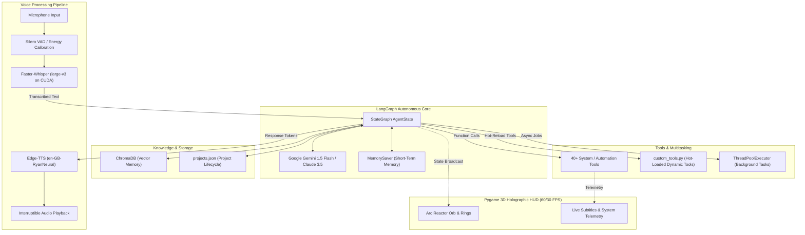

<div align="center">


<br/>

<p align="center">
  
  
  
  
  
  
  
  
</p>

<br/>

> *"Sometimes you gotta run before you can walk."* — Tony Stark

<br/>

A fully autonomous, voice-controlled Agentic AI desktop assistant built with **LangGraph StateGraph**, **Google Gemini & Anthropic Claude**, **GPU-accelerated Faster-Whisper transcription**, **ChromaDB vector memory**, **real-time interruptible Edge TTS**, **parallel tool dispatching**, and an **interactive 3D holographic Arc-Reactor HUD** — engineered from the ground up to bring the Marvel JARVIS experience to your Windows workstation.

<br/>

---

</div>

## 📑 Table of Contents

- [✦ Visual States & Holographic HUD](#-visual-states--holographic-hud)
- [⚡ Key Architecture & Highlights](#-key-architecture--highlights)
- [🛠️ 40+ Autonomous Tool Arsenal](#️-40-autonomous-tool-arsenal)
- [🏗️ System Architecture](#️-system-architecture)
- [🚀 Quickstart & Installation](#-quickstart--installation)
- [🗣️ Wake Words & Voice Controls](#️-wake-words--voice-controls)
- [📁 Project Layout](#-project-layout)
- [🗺️ Future Roadmap](#️-future-roadmap)
- [🤝 Contributing & License](#-contributing--license)

---

## ✦ Visual States & Holographic HUD

J.A.R.V.I.S. features an authentic, dynamic **Arc Reactor HUD** rendered via Pygame. The core dynamically warps with sine-wave particle deformations synchronized with speech and system state:

<div align="center">

| State | HUD Orb Color | Visual Behavior | Description |
|:---:|:---:|:---|:---|
| 💤 **Asleep** | Dim Blue `#1E3C5A` | Slow, gentle pulse | Low-power standby awaiting wake word |
| 🎙️ **Listening** | Emerald Green `#00FF96` | Rapid distortion pulse | Faster-Whisper actively capturing voice input |
| 🧠 **Thinking** | Amber Orange `#FF9600` | High-speed orbital spin | LangGraph & Gemini/Claude reasoning over tools |
| 🔊 **Speaking** | Cyber Cyan `#00C8FF` | Sine-wave audio deformation | Edge-TTS streaming playback with live microphone listening |
| ✅ **Idle** | Cerulean Blue `#0096FF` | Smooth harmonic float | System ready and awaiting next command |

</div>

- **Dynamic Subtitle Bar**: Displays real-time transcription of user speech and assistant responses.
- **System Execution Overlay**: Emits live telemetry (`[ SYSTEM EXECUTING ]: tool_name...`) while parallel background or foreground routines execute.

---

## ⚡ Key Architecture & Highlights

### 🤖 LangGraph Multi-Round Autonomous Loop
- **Cyclic Agentic Decision Loop**: Powered by `langgraph.graph.StateGraph` with short-term checkpoints (`MemorySaver`).
- **5-Round Deep Tool Chaining**: JARVIS iteratively selects tools, receives execution outputs, reasons over observations, and dispatches follow-ups autonomously.
- **Parallel Dispatch Engine**: Dispatches compound actions (e.g., *"Open Chrome, launch VS Code, and search for the latest AI news"*) concurrently using `ThreadPoolExecutor`.
- **Intelligent Clarification**: Recognizes ambiguities and asks interactive follow-up questions (`[FOLLOW_UP]`), seamlessly continuing the conversation upon listening to your response.

### 🎙️ Local CUDA Voice Pipeline with Real-Time Interruption
- **Faster-Whisper `large-v3` on NVIDIA CUDA**: Near-zero-latency local speech-to-text with Voice Activity Detection (VAD) and hallucination filters.
- **British Vocal Persona**: Powered by Microsoft Edge TTS (`en-GB-RyanNeural`) for a polished, Iron Man-inspired British voice with zero cloud API costs.
- **Mid-Speech Barge-In / Interruption**: Speak *"stop"*, *"quiet"*, *"shut up"*, or *"cancel"* while JARVIS is speaking to immediately cut off playback and pass control back to your voice.

### 🧠 Semantic Vector Memory & Project Lifecycle
- **ChromaDB Vector Store**: Automatically embeds facts, preferences, contacts, and personal information into a local vector database for fast semantic similarity search (`fetch_memory`, `remember_information`).
- **Autonomous Project Tracker**: Create and track ongoing projects, paths, and status updates stored in structured JSON (`start_project`, `update_project`, `get_projects`, `complete_project`).

### ⚙️ Self-Improving Tool Ecosystem
- **Runtime Code Generation**: When faced with unfamiliar tasks, JARVIS can author new Python functions via `create_new_tool` and immediately hot-reload them from `custom_tools.py` without restarting the process.
- **Sandboxed Code Execution**: Run on-the-fly Python scripts and calculations directly with `run_python_code`.
- **Background Multitasking**: Long-running shell commands, builds, and package downloads run asynchronously; JARVIS audibly informs you the second they finish.

---

## 🛠️ 40+ Autonomous Tool Arsenal

<details open>
<summary><b>▶ Click to inspect all built-in capabilities</b></summary>

<br/>

### 🌐 Web & Knowledge Retrieval
| Tool | Description |
|:---|:---|
| `web_search_and_summarize` | Live DuckDuckGo search with instant 5-source synthesis |
| `get_latest_news` | Real-time news extraction filtered by category or topic |
| `browse_website` | Full webpage scraper using BeautifulSoup (extracts 2,500 clean text chars) |
| `search_wikipedia` | Direct encyclopedia query returning concise factual summaries |

### 💻 System & Windows Desktop Control
| Tool | Description |
|:---|:---|
| `open_application` | Launches Windows desktop software (VS Code, Chrome, Terminal, etc.) via `AppOpener` |
| `close_application` | Gracefully closes running desktop applications by title |
| `open_website` | Directly opens URLs in Google Chrome |
| `open_file_or_folder` | Opens files/folders with associated native OS handlers (`os.startfile`) |
| `run_terminal_command` | Executes Windows CMD commands synchronously and captures stdout/stderr |
| `run_background_task` | Launches background shell jobs in a separate worker thread pool |
| `check_background_tasks` | Telemetry on active and queued background jobs |
| `system_control` | Hardware control: Volume Up/Down, Mute, Lock Workstation, Play/Pause, Next Track |
| `get_system_stats` | Real-time hardware telemetry: CPU load %, RAM utilization %, and Battery status |
| `get_time` | Fetches local workstation timestamp |

### 🖱️ Mouse, Keyboard & Automation
| Tool | Description |
|:---|:---|
| `mouse_click` | Left-click, double-click, or right-click at explicit `(x, y)` coordinates |
| `mouse_move` | Smooth, interpolated cursor navigation to screen targets |
| `mouse_drag` | Click-and-drag interactions for windows, sliders, and canvas elements |
| `mouse_scroll` | Vertical scrolling (positive for up, negative for down) |
| `type_text` | Types text strings into the currently focused window character-by-character |
| `press_key` | Dispatches single keys and hotkey combinations (`ctrl+c`, `alt+tab`, `win`) |
| `get_clipboard` | Inspects current system clipboard contents |

### 👁️ Screen Vision & OCR
| Tool | Description |
|:---|:---|
| `take_screenshot` | Captures high-resolution timestamped PNG screenshots |
| `analyze_screen` | Multimodal Vision model evaluates active screen content and UI layouts |
| `find_text_on_screen` | Tesseract OCR scans the monitor to return coordinate bounding boxes for text |
| `list_windows` | Enumerates all visible desktop windows, positions, and dimensions |
| `get_active_window` | Identifies the currently focused window title |

### 🧠 Vector Memory & Project Management
| Tool | Description |
|:---|:---|
| `remember_information` | Embeds personal facts into local ChromaDB vector storage |
| `fetch_memory` | Semantic similarity query to retrieve relevant stored knowledge |
| `update_memory` | Updates an existing vector memory entry by UUID |
| `delete_memory` | Deletes a specific memory record from ChromaDB |
| `clear_all_memories` | Wipes the persistent vector collection |
| `search_contact` | Fast lookup for remembered telephone numbers, emails, and names |
| `start_project` | Initiates tracking for a development project with a directory path |
| `update_project` | Logs progress updates and notes against an active project |
| `get_projects` | Lists all active projects and latest milestone updates |
| `complete_project` | Archives a completed project |

### 📬 Messaging & Communication
| Tool | Description |
|:---|:---|
| `send_whatsapp_message` | Automated message dispatching via `pywhatkit` Web automation |
| `send_email` | Transmits emails via Gmail SMTP using secure App Passwords |

### 🔧 Self-Improvement & Custom Tools
| Tool | Description |
|:---|:---|
| `create_new_tool` | Autonomously codes new Python tools into `custom_tools.py` and hot-loads them |
| `run_python_code` | Sandboxed Python code execution for instant mathematical and logical computing |
| `play_spotify_music` | Searches and triggers song playback in Spotify Web |

</details>

---

## 🏗️ System Architecture



---

## 🚀 Quickstart & Installation

### Prerequisites

- **Operating System**: Windows 10 / 11 (64-bit)
- **Python**: 3.10 or higher
- **GPU**: NVIDIA GPU with CUDA 12.0+ (CUDA Toolkit & cuDNN installed)
- **Google Gemini API Key**: Free tier from [Google AI Studio](https://aistudio.google.com/)

### 1. Clone the Repository

```bash
git clone https://github.com/Shivam1981-leo/JARVIS-AGENTIC-AI-voice-assistant.git
cd JARVIS-AGENTIC-AI-voice-assistant
```

### 2. Set Up a Virtual Environment

```bash
python -m venv .venv
.\.venv\Scripts\activate
```

### 3. Install Dependencies

```bash
pip install -r requirements.txt
```

> **PyAudio on Windows**: If `pyaudio` installation encounters compilation errors, install via prebuilt wheel:
> ```bash
> pip install pipwin
> pipwin install pyaudio
> ```

> **CUDA Accelerated Faster-Whisper**: Verify your CUDA environment and drivers (`nvidia-smi`). Ensure PyTorch and cuDNN can access GPU acceleration.

### 4. Configure Environment Variables

Copy the `.env.example` template to `.env`:

```bash
copy .env.example .env
```

Open `.env` and fill in your keys:

```env
# Google Gemini (Primary Agent Model)
GEMINI_API_KEY=AIzaSy...

# Anthropic Claude (Optional / Screen Vision Fallback)
ANTHROPIC_API_KEY=sk-ant-...
ANTHROPIC_BASE_URL=http://localhost:20128/v1
ANTHROPIC_MODEL=kr/claude-sonnet-4.5

# Gmail SMTP Configuration (Required only for send_email tool)
GMAIL_USER=your_email@gmail.com
GMAIL_PASSWORD=your_gmail_app_password
```

### 5. (Optional) Install Tesseract OCR

To enable screen coordinate text detection via `find_text_on_screen`:
1. Download installer from [UB-Mannheim Tesseract OCR](https://github.com/UB-Mannheim/tesseract/wiki).
2. Install to `C:\Program Files\Tesseract-OCR`.
3. Add `C:\Program Files\Tesseract-OCR` to your Windows System `PATH`.

### 6. Launch J.A.R.V.I.S.

```bash
python main.py
```

Upon launch, JARVIS will:
1. Verify NVIDIA GPU & initialize `large-v3` Whisper in float16.
2. Initialize LangGraph tools and load dynamic scripts from `custom_tools.py`.
3. Play the startup chime (`startup.mp3`) and render the holographic Pygame HUD.
4. Deliver a live weather and date briefing from `wttr.in`.
5. Enter standby mode awaiting your wake word!

---

## 🗣️ Wake Words & Voice Controls

| Command Phrase | Triggered Behavior |
|:---|:---|
| `"Wake up Jarvis"` | Wakes JARVIS from low-power sleep mode into active listening |
| `"Jarvis, [your command]"` | Directly execute any command from standby |
| `"Sleep"` / `"Go to sleep"` | Returns JARVIS to sleep mode |
| `"Stop"` / `"Quiet"` / `"Shut up"` / `"Cancel"` | **Instant mid-speech barge-in** — halts speech playback immediately and starts listening |
| `"Exit"` / `"Shut down"` / `"Goodbye"` | Shuts down background workers and exits the application |

### Example Voice Interactions

- *"Jarvis, open VS Code and Chrome side by side."*
- *"Search for recent breakthroughs in quantum computing and summarize them."*
- *"Remember that my primary database port is 5432."*
- *"What did I tell you about my database port?"*
- *"Take a screenshot, analyze my screen, and tell me what error is shown."*
- *"Start a new project called Jarvis Mobile located at D:\Projects\Mobile."*
- *"Run pip install pytest in the background and let me know when it's done."*
- *"Turn the volume down and play the next track."*
- *"Write a Python script for Dijkstra's algorithm and save it as dijkstra.py."*
- *"Send an email to team@company.com with the subject 'Daily Standup'."*

---

## 📁 Project Layout

```
JARVIS-AGENTIC-AI-voice-assistant/
│
├── main.py              # Main application entry point: LangGraph agent, HUD, Voice pipeline
├── custom_tools.py      # Runtime self-extensible tools (hot-reloaded dynamically)
├── requirements.txt     # Complete Python package dependency manifest
├── .env.example         # Environment template with documented keys
├── .gitignore           # Git ignore rules for logs, virtual environments, audio artifacts
├── startup.mp3          # Startup sound effect played on initialization
├── memory.json          # Legacy memory store backup
├── projects.json        # Structured project tracking repository
└── README.md            # Comprehensive project documentation
```

---

## 🗺️ Future Roadmap

- [x] Multi-round LangGraph cyclic agent reasoning with tool checkpointing
- [x] Faster-Whisper `large-v3` running strictly on NVIDIA CUDA
- [x] ChromaDB semantic vector memory bank
- [x] Real-time mid-speech microphone barge-in interruption
- [x] Self-improving runtime tool generation (`custom_tools.py`)
- [ ] Local streaming audio transcription (real-time word-by-word STT display)
- [ ] Multi-screen HUD support for multi-monitor desktop setups
- [ ] Native Spotify Web API OAuth2 integration
- [ ] Mobile companion interface via local WebSocket bridge

---

## 🤝 Contributing & License

Contributions, issues, and feature suggestions are welcome!

1. Fork the Project (`https://github.com/Shivam1981-leo/JARVIS-AGENTIC-AI-voice-assistant`)
2. Create your Feature Branch (`git checkout -b feature/NewFeature`)
3. Commit your Changes (`git commit -m 'Add NewFeature'`)
4. Push to the Branch (`git push origin feature/NewFeature`)
5. Open a Pull Request

Distributed under the **MIT License**. See `LICENSE` for more information.

---

<div align="center">

**Crafted with precision by [Shivam Shirsat](https://github.com/Shivam1981-leo)**

⭐ **Star this repository if JARVIS inspired your AI projects!**

</div>